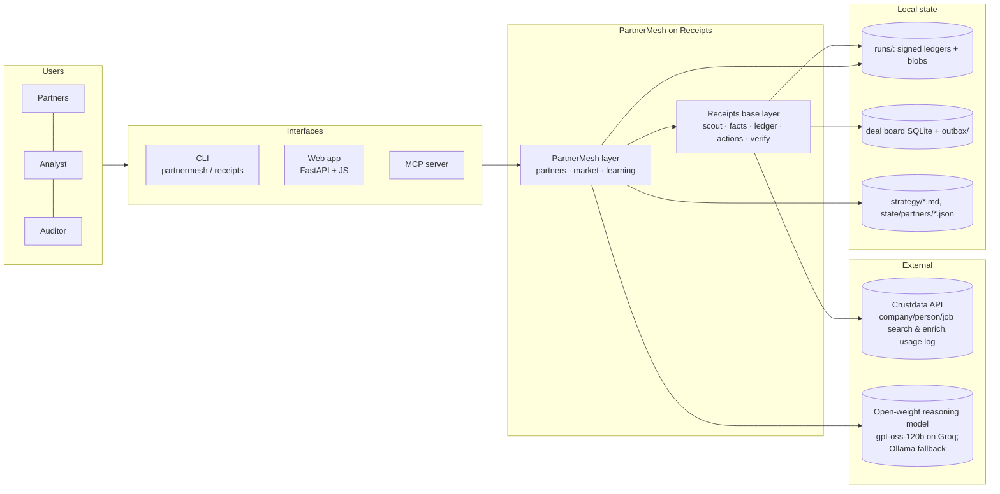
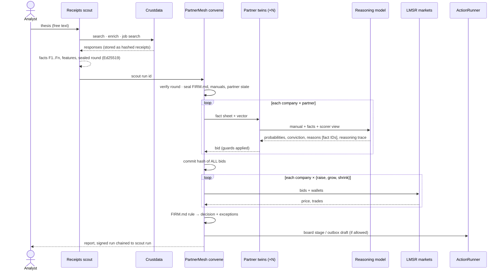

# PartnerMesh on Receipts: High-Level Design

## 1. Purpose
A venture fund's first-pass investing work (sourcing, screening, investment-committee debate, outreach)
is done by analysts and partners by hand, and none of it can be audited later. PartnerMesh automates the
work end to end:

- each partner's judgement runs as an AI twin with its own written manual;
- the twins' disagreement turns into one firm decision through an internal prediction market;
- the firm learns from real outcomes whose judgement to trust on which question;
- every fact, bid, decision and action is signed and can be replayed.

**Scope:** sourcing → screening → partner decision → board update and drafted outreach → outcome learning.
**Out of scope:** sending messages to real people (competition rule 4), term sheets, portfolio management.

## 2. Users
| User | Interacts via | Does |
|---|---|---|
| Partner | writes `strategy/partners/<name>.md` | defines their twin's judgement, hard rules and starting priors |
| Fund admin | `strategy/STRATEGY.md`, `strategy/FIRM.md` | sets thesis, guardrails and allowed actions, plus partnership rules (questions, market, decision formula) |
| Analyst / partner on duty | Web app, CLI | runs a thesis, reviews the exception queue, approves outbox drafts, reports outcomes |
| Auditor / LP / judge | `receipts verify`, web Audit page | re-proves any run without trusting the agent |
| Other AI agents | MCP server | call the same tools under the same rules |

## 3. System context


## 4. Architecture: two layers
| Layer | Package | Responsibility | Key modules |
|---|---|---|---|
| **Receipts** (base, by Sandipan-87) | `receipts/` | One fund agent: thesis → Crustdata → receipt-backed facts → features → learned scoring → sealed predictions → rule-bounded actions. Pitch checking. Signed ledger and verifier. Web app. MCP. | `scout.py`, `proxy.py` (receipt-recording client), `facts.py`, `features.py`, `ledger.py` (hash chain + Ed25519), `actions.py`, `verify.py`, `webapp.py`, `mcp_server.py` |
| **PartnerMesh** (partnership) | `partnermesh/` | Many partner twins → sealed bids → per-question prediction markets → firm decision → actions. Outcome settlement, backtest. | `firm.py` (convene), `partners.py` (twins), `market.py` (scorers, LMSR, decision rule), `signals.py` (features, point-in-time, labels), `learning.py` (settle, backtest), `llm.py` |

**Integration contract:** PartnerMesh never calls Crustdata or writes the deal board directly. It reads
**sealed** Receipts scout rounds, writes its own runs with Receipts' `Ledger`, acts through Receipts'
`ActionRunner`, and is verified by Receipts' `verify`, extended with a `market` run kind.

## 5. Components
| Component | Input → output | Notes |
|---|---|---|
| **Scout** (Receipts) | thesis text → sealed round (`round.json`, `facts.json`) | LLM proposes filters, code validates them; filters are relaxed in steps and each relaxation is logged |
| **Proxy** (Receipts) | API request → receipt (ledger entry + content-addressed blob) | captures request ID and credits for the witness check; retries and caching |
| **Partner twin** | manual + fact sheet + feature vector → sealed bid on 3 questions | bid = `model_blend`·learned scorer + (1−blend)·reasoning model; reasons cite fact IDs |
| **Scorer** (one per partner per question) | feature vector → probability | logistic regression, L2-anchored to the manual's priors, SGD on outcomes |
| **LMSR market** (one per company per question) | bids + wallets → price, trades | low liquidity, 80 alternating micro-rounds, stake = wallet × conviction × risk; deterministic |
| **Firm decision** | 3 prices → PURSUE/WATCH/PASS + splits | `score = 1.0·raise + 0.5·grow − 1.5·shrink` (FIRM.md) |
| **Guards** | bids, raw facts → exceptions | partner split ≥ 0.35, identity collision, investment firm, model failure, invalid citation, untraceable number |
| **ActionRunner** (Receipts) | decision → board stage, outbox draft | each action checked against STRATEGY.md `actions.allowed`; forbidden actions are blocked and logged |
| **Settle** | outcome (company, question, 0/1) → wallets, scorers, lessons | signed run, references the market run's head |
| **Backtest** | query, as-of date → learning curve | point-in-time features, labels from later data, all calls receipted |
| **Verify** (Receipts + market check) | run dir → ✔/✘ per check | no LLM; replays markets and decisions |

## 6. Key flows

### 6.1 Thesis → firm decision


### 6.2 Outcome → learning
```mermaid
flowchart LR
  O[Observed outcome<br/>company · question · 0/1] --> ST[Settle market trades<br/>winning shares pay 1]
  ST --> W[Wallet(partner, question) ± P&L]
  O --> G[Scorer SGD step<br/>L2 toward manual priors]
  W & G --> LS[Lesson appended to<br/>partner manual]
  LS --> SIG[Signed settle run<br/>references market head]
  W --> NEXT[Next convene:<br/>bigger wallet = more stake = more influence]
```

### 6.3 Backtest (leakage-free)
1. Search Crustdata for companies founded before the as-of date (receipted).
2. Enrich with time series: headcount, funding milestones, open jobs, founders.
3. `pit_raw()` truncates every series at the as-of date, so the features only see the past.
4. `labels()`: raise = a funding milestone within 18 months; grow or shrink = headcount 12 months later compared with as-of.
5. Batches: predict → market → Brier score → settle → update. Wallets and the curve are sealed.

### 6.4 Verify
Chain → Ed25519 signature → blobs → facts → (market) input round → manuals and state → sealed bids → market replay → actions → report hash. Optional `--witness`: each call is matched against Crustdata's usage log.

## 7. Data design
**Run directory** (`runs/<kind>_<timestamp>/`): `ledger.jsonl` (hash chain), `blobs/sha256/*` (raw API responses and reasoning traces), `head.sig` (Ed25519 over the head), `meta.json`, `report.md`, plus per kind: `round.json` + `facts.json` (scout), `market.json` (market).

**Market-run ledger entries** (in order):
`run_start` → `strategy` → `firm_rules` → `input_round` → `partner_manual`×N → `partner_state`×N →
(`model_call` | `model_failure`) + `sealed_bid` per company×partner → `bids_committed` →
`market` per company×question → `firm_decision` + `action` per company → `claim_set` → `report`.

**Partner state** (`state/partners/<p>.json`): per question `{w, b, prior, prior_b, wealth, updates, brier[]}`.

**Bid**: `{partner, questions: {q: {probability, p_model, p_llm, conviction, reasons[{claim, facts[]}], drivers}}, risks, rule_flags, invalid_citations, untraceable_numbers, model_failed}`.

## 8. Decision mechanism
- **Why LMSR:** prices are probabilities, the market maker's loss is bounded, and a partner's influence is capped by its budget. With alternating micro-trades the clearing price is a wallet-and-conviction-weighted compromise with no last-mover edge.
- **Why per-question wallets:** they assign credit, so a partner can be trusted on *grow* and discounted on *raise*.
- **Why a blended bid:** the learned scorer is calibrated and learns from outcomes; the reasoning model reads the manual's nuance and qualitative facts. Either one alone is weaker, and if the model fails the bid falls back to the scorer and the run is flagged.

## 9. Trust and safety
| Risk | Control |
|---|---|
| Hallucinated facts | reasons must cite fact IDs that exist in the round; numbers must be facts or one arithmetic step away; violations go to a human |
| Hindsight editing of bids | all bids hash-committed before any market opens; the ledger is chained and signed |
| Altered input data | convene re-verifies the scout round; verify pins the round and facts hashes and the scout head |
| Unauthorised actions | ActionRunner checks STRATEGY.md; `send_external_email` and `contact_any_person` are forbidden, blocked and logged |
| Merged or garbage entity records | identity-collision check; conviction capped; human review |
| Wrong entity type (investment firms) | name guard → human review |
| Secrets | `.env` and `keys/` are git-ignored; keys never enter ledgers |

## 10. Interfaces
**CLI:** `partnermesh run | convene | settle | backtest`; `receipts scout | decide | run --pitch | verify | tamper | view | board`.
**REST** (web app): `POST /api/market/run`, `/api/market/convene`, `/api/market/settle`, `/api/market/backtest`; `GET /api/market/{run}`, `/api/partners`; plus Receipts' endpoints. Long tasks run as jobs whose trace streams live.
**MCP tools:** `convene_partners`, `settle_outcome`, `partners`, plus Receipts' `scout_round`, `check_pitch`, `record_decisions`, `verify_run`, `deal_board`, `get_strategy`.

## 11. External dependencies and failure handling
| Dependency | Failure | Handling |
|---|---|---|
| Crustdata | 429/5xx, transport errors | retries with `retry-after`/backoff; failed attempts logged as receipts; cache avoids paying twice |
| Crustdata | ambiguous or merged entities | Receipts refuses to guess; identity-collision guard |
| Reasoning model | rate limit / outage | `retry-after`, fallback gpt-oss-120b → gpt-oss-20b, then scorer-only bid flagged for a human |
| Reasoning model | malformed JSON / bad citations | parser fallback; invalid citations dropped and flagged |

## 12. Non-functional
- **Determinism:** everything after the bids is pure code, so verification is exact replay.
- **Cost:** about 2 credits per enriched company plus search fees; the partner layer adds no Crustdata calls.
- **Latency:** about 1 minute to scout 5 companies, plus 1–2 minutes of partner bidding on the free-tier model.
- **Extensibility:** add a partner by writing a manual and listing it in FIRM.md; add a question by adding it to FIRM.md, priors and a label function.

## 13. Limitations and roadmap
- The backtest sample is small, and founder data in backtests uses current profiles.
- The number guard is probabilistic on fact-dense companies (16/20 planted numbers caught, 0/66 false alarms).
- Next steps: more questions (founders stay, top-tier lead investor, acquisition); automatic settlement via Crustdata watchers when horizons pass; per-partner fine-tuning of an open model on its own sealed history; anchoring run heads externally.
