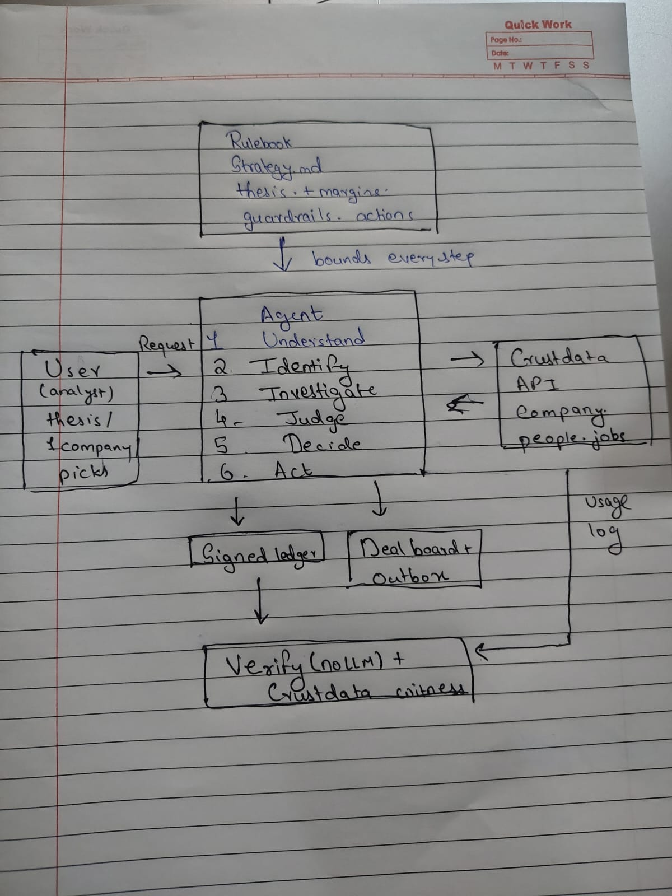

# HLD: Receipts high-level design

## Components
| Box in the diagram | What it is | Where it lives |
|---|---|---|
| **Rulebook** | The fund's written rules: thesis (hard filters), ± margins for checking claims, guardrails, allowed and forbidden actions, autonomy limits. It **bounds every step** of the agent, and its full text is sealed into every run. | `strategy/STRATEGY.md`, `receipts/strategy.py` |
| **User (analyst)** | Gives the request: a free-text thesis, an inbound pitch, one company to analyse, or picks on a scouted round. | Web app (`receipts/webapp.py`), CLI, MCP server |
| **Agent** | Runs six steps; each is described below. | `receipts/agent.py`, `scout.py`, `decide.py`, `thesis.py`, `resolve.py`, `claims.py`, `learn.py` |
| **Crustdata API** | The source of truth: company search, identify, enrich, autocomplete; person search (current and former employees, founders); job search. | `receipts/proxy.py` (REST, `x-api-version: 2025-11-01`) |
| **Signed ledger** | Every API call, decision and action is appended as a receipt: raw response hash, Crustdata request ID, credits, and the previous entry's hash. The chain head is signed with Ed25519. | `receipts/ledger.py`, `runs/<run>/` |
| **Deal board + Outbox** | Where the agent's actions land: stage changes on a SQLite deal board, and drafted founder emails (never sent automatically). | `receipts/board.py`, `receipts/actions.py`, `outbox/` |
| **Verify (no LLM) + Crustdata witness** | Recomputes everything from the raw responses, and checks each call against Crustdata's own usage log. | `receipts/verify.py` |

## The agent's six steps
1. **Understand.** The LLM (Ollama `beam`, falling back to `gemma4:31b`, then rules) turns the pitch or thesis into structured claims or filters. Code validates every value; industries are checked against Crustdata's autocomplete.
2. **Identify.** Resolve the company and people to Crustdata IDs. If it's ambiguous, the agent refuses to guess (e.g. 25 companies named "Mercury"; 6 people named "Max", where the one holding the CTO role is chosen).
3. **Investigate.** Fetch the facts needed. Each response is stored as a content-addressed blob, and each fact is a JSON pointer into it.
4. **Judge.** Deterministic comparators check claims within the rulebook's margins. Unstable or merged data is never held against a company. Companies are scored with the learned preference model.
5. **Decide.** Apply the rulebook: ADVANCE, REQUEST INFO, PASS or NEEDS HUMAN. Predictions are sealed before the human chooses.
6. **Act.** Update the deal board and draft emails, alone only above 80% confidence and after at least 10 learned decisions. Each action records the rule that allowed it.

## Flows (the arrows)
- **Rulebook → Agent:** bounds every step.
- **User → Agent:** the request.
- **Agent ↔ Crustdata:** every call becomes a receipt.
- **Agent → Signed ledger, and Agent → Deal board + Outbox:** every decision is recorded, and every action is executed within the rules.
- **Signed ledger → Verify ← Crustdata usage log:** independent re-verification of the whole run.
- **Learning loop** (not drawn): the agent seals its predictions, the user picks, the agent scores itself and re-fits the preference model. In our live test it matched 7/10 decisions in round 1 and 9/10 in round 2.
